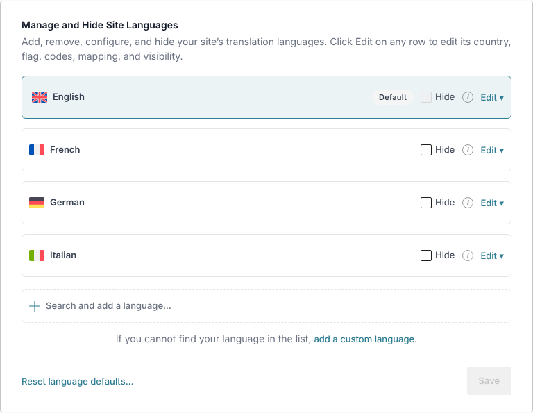
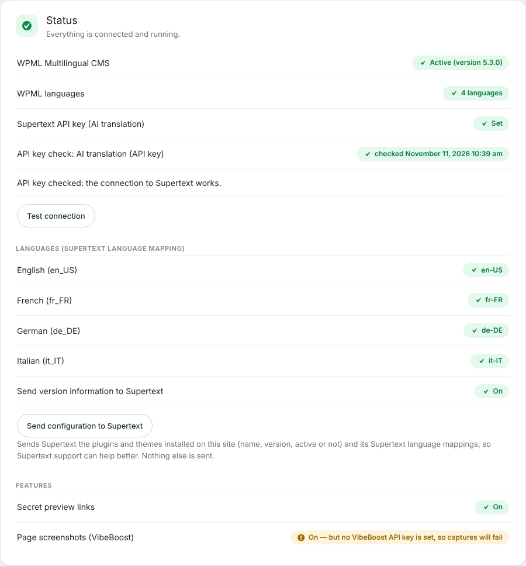
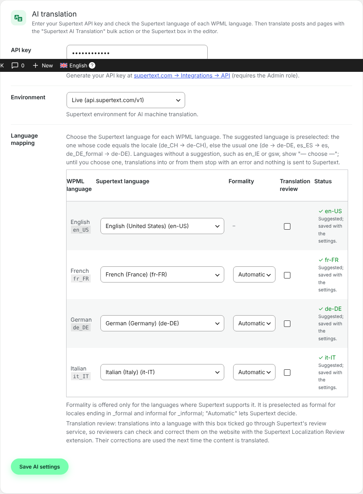
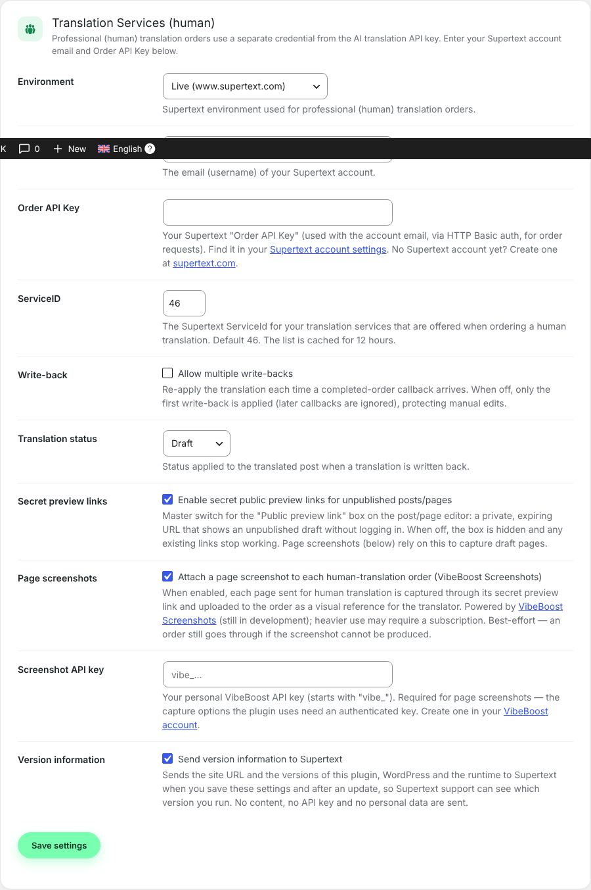

# Installation guide

For administrators: how to install and set up **Supertext for WPML**. Editors: see the [user guide](USER_GUIDE.md).

> The screenshots come from a test site with WPML 5.3.0 and the demo's sample content. Translations come from a stand-in for the Supertext API (`tests/e2e/stand-in/`), so no API key was needed.

## Requirements

- WordPress 6.4 or later, PHP 8.2 or later (PHP 8.1 is end of life).
- **WPML Multilingual CMS** (the `sitepress-multilingual-cms` plugin), set up with at least two languages. WPML String Translation and WPML's Translation Management are not needed.
- A Supertext account:
  - **AI translation**: an API key. No Supertext account yet? Create one at <https://www.supertext.com/person/en/account/signin>. Generate your API key at supertext.com → Integrations → API, <https://www.supertext.com/en/integrations/api> (requires the **Admin** role).
  - **Professional (human) translation** (optional): your account email and the *Order API Key* from your Supertext account settings.
- The server must reach `https://api.supertext.com` (AI translation) and `https://www.supertext.com` (orders). For orders, Supertext must reach your site's REST API (`/wp-json/supertext-wpml/v1/…`) to deliver the translation.

## Install, update, uninstall

1. Download `supertext-wpml-X.Y.Z.zip` from the [releases](https://github.com/supertext/Wordpress-WPML-Supertext-Translation-Public/releases) (or build it: the `supertext-wpml` folder with `supertext-wpml.php`, `includes/`, `assets/`, `languages/`).
2. **Plugins → Add New → Upload Plugin**, choose the zip, **Install Now**, **Activate**.
3. Open **Supertext → Settings**.

**Update:** upload the new zip and confirm *Replace current with uploaded*. Settings, orders and translations stay.

**Uninstall:** deactivate and delete the plugin. Translations created with Supertext are ordinary WPML translations and stay. The plugin's options (`supertext_wpml_ai`, `supertext_wpml_settings`, `supertext_wpml_reporter`, `supertext_wpml_orders`, …) stay in the database until you delete them.

If WPML isn't active, the plugin shows *Supertext for WPML requires WPML Multilingual CMS to be active.* and translates nothing.

## WPML setup

In WPML:

- **WPML → Languages:** add your languages. Each WPML language has a *locale* (e.g. `de_CH`, under *Edit*); the plugin uses it to suggest the Supertext language.

  
- **WPML → Settings → Post Types Translation:** set the post types you want to translate (posts, pages, custom types) to *Translatable*. Only these get the Supertext box and bulk actions.
- **WPML → Settings → Custom Fields Translation:** fields set to *Translate* are sent to Supertext (with a single text value), *Copy* fields are copied into the translation, *Copy once* fields only into a new translation. Many plugins set this up through their `wpml-config.xml` (e.g. Yoast SEO's title and description).
- **WPML → Settings → How to translate posts and pages:** if you edit Supertext translations by hand, choose *Use the WordPress Editor* for them. WPML's Advanced Translation Editor doesn't know about translations created outside it and may offer to translate them again.

## Status

**Supertext → Settings** starts with the status: WPML, its languages, the API key and its last check, the Supertext language of every WPML language, version information and the optional features. Red rows still need setting up. **Test connection** checks the AI key (and the order credentials, once they are set) right away.

## AI translation settings

| Setting | What it does |
| --- | --- |
| **API key** | Your Supertext API key. A pasted `Supertext-Auth-Key ` prefix is removed. Saving checks the key (free) and shows the result. While the field is empty, `SUPERTEXT_API_KEY` (wp-config.php constant or environment variable) is used. No Supertext account yet? Create one at supertext.com. Generate your API key at supertext.com → Integrations → API (requires the Admin role). |
| **Environment** | Live (`api.supertext.com`); Staging and Testing are for Supertext's own tests. |
| **Language mapping** | One row per WPML language. **Supertext language**: preselected with the suggestion (the code that equals the locale, `de_CH` → `de-CH`, else the usual one, `de_DE` → `de-DE`, `es_ES` → `es`, `de_DE_formal` → `de-DE`). Languages without a suggestion (e.g. `en_IE`, `gsw`) show *— choose —*; until you choose one, translations into or from them stop with an error and nothing is sent. **Formality**: only where Supertext offers it; preselected *Formal* for `_formal` locales. **Translation review**: translations into this language go through Supertext's review service, so reviewers can correct them on the website with the Supertext Localization Review extension. **Status**: the code that is actually used. |

Click **Save AI settings**.

## Professional (human) translation settings

| Setting | What it does |
| --- | --- |
| **Environment** | Live (`www.supertext.com`). |
| **Account email**, **Order API Key** | Your Supertext login email and the Order API Key from your [Supertext account settings](https://www.supertext.com/services/customer/accountsettings). No Supertext account yet? Create one at supertext.com. |
| **ServiceID** | The group of translation types offered when ordering (default 46: Basic, Premium, Creative). Cached for 12 hours. |
| **Write-back** | *Allow multiple write-backs*: apply a delivery again if Supertext sends it again. Off: the first delivery wins, so later edits are kept. |
| **Translation status** | *Draft* (default): new translations are drafts; existing ones keep their status. *Published*: delivered translations are published. |
| **Secret preview links** | A private, expiring link to unpublished drafts (box in the editor), also used for page screenshots. |
| **Page screenshots** | Attaches a screenshot of the page to each order as a reference for the translator (needs a VibeBoost API key). |
| **Version information** | Sends the site URL and the versions of this plugin, WordPress and PHP to Supertext after saving and after updates, so support can see what you run. No content, no API key, no personal data. `SUPERTEXT_VERSION_REPORTS=off` on the server turns it off whatever the setting says. |

Click **Save settings**.

## Who can do what

- Settings, status, debug: `manage_options` (administrators).
- Translating, ordering, translation files: anyone who can edit the post (and its translation, or create posts of its type) — editors included.

## Troubleshooting

| Message | What to do |
| --- | --- |
| *Supertext for WPML requires WPML Multilingual CMS to be active.* | Install and activate WPML and finish its setup wizard. |
| *No Supertext API key is set.* | Enter the key under **Supertext → Settings → AI translation**. |
| *Authentication failure. Please check your Supertext API key.* | The key is wrong or was deleted. Copy it again from supertext.com → Integrations → API (Admin role). |
| *… has no Supertext language, so nothing was sent to Supertext.* | Choose a Supertext language for that WPML language in the language mapping. |
| *Supertext does not support this language pair* | Check the mapping: the target must be one of the offered Supertext languages. |
| *WPML does not translate this post type.* | WPML → Settings → Post Types Translation: set it to *Translatable*. |
| *Your Supertext translation limit is exceeded.* | Upgrade your Supertext subscription. |
| *Timed out waiting for the Supertext translation to finish.* | Very long content: try again; raise PHP's `max_execution_time` if your host allows it. |
| Orders never come back | Supertext must reach `/wp-json/supertext-wpml/v1/…` on your site (no login wall, no firewall rule against it). **Supertext → Debug** shows the callbacks that arrived. |
| Supertext language strings in English | Install the WordPress language pack of your back-end language; the plugin's own texts are in German, French and Italian too. |
