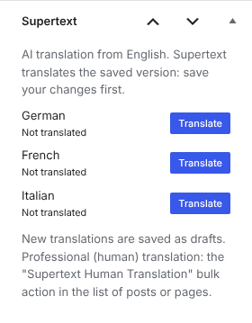
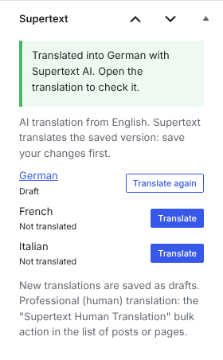
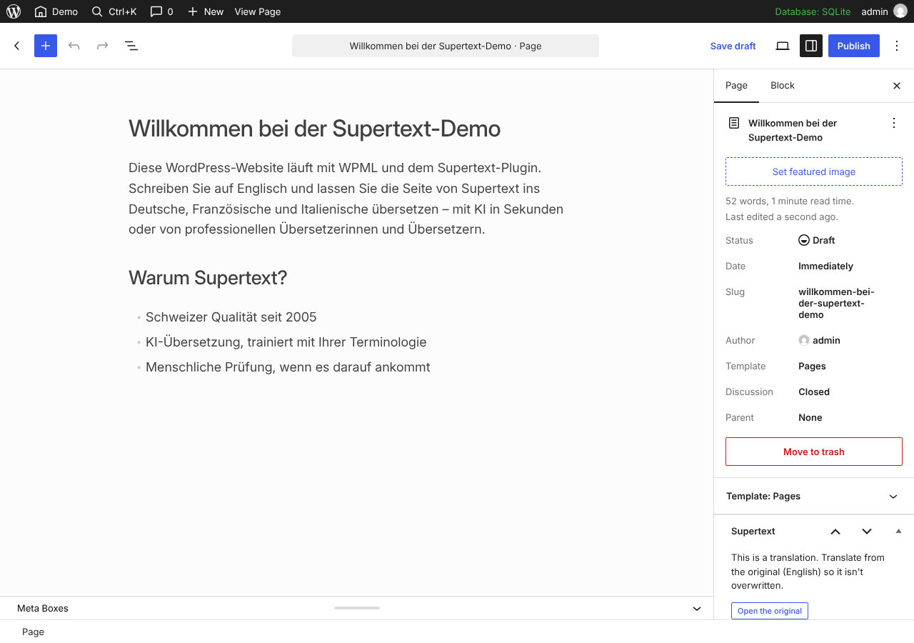
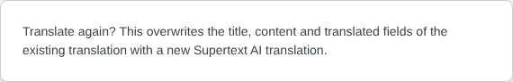
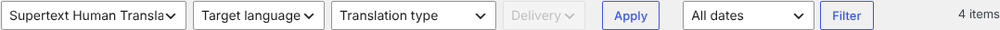
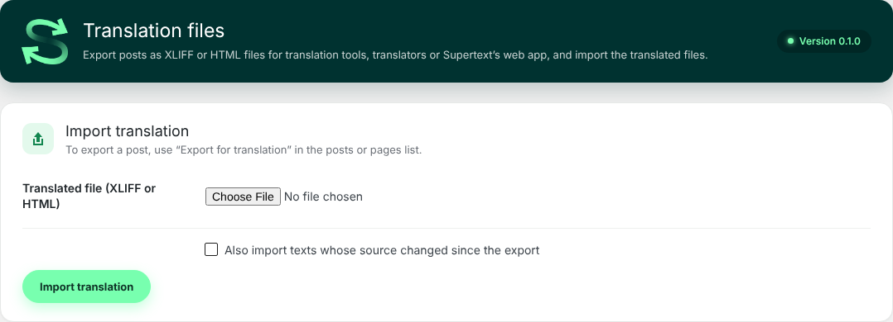

# User guide

For editors: how to translate posts and pages with **Supertext for WPML**. Setting it up: see the [installation guide](INSTALLATION.md).

> The screenshots come from the repository's test site with a stand-in for WPML's hooks and for the Supertext API (`tests/e2e/stand-in/`); the translations shown are real ones of the sample page.

Supertext translates from the **original** of a post (the version in the language you wrote it in) into your other WPML languages. The translation is an ordinary WPML translation: it shows up in WPML's language columns and language switcher, and you can edit it like any other post.

## Translate one post with AI: the Supertext box

Open the original post or page in the editor. The **Supertext** box (in the sidebar of the block editor, among the boxes of the classic editor) lists your other languages:

1. **Save your changes first:** Supertext translates the saved version.
2. Click **Translate** next to a language. Supertext translates title, content, excerpt, the custom fields WPML translates (e.g. the SEO title) and categories and tags that have no translation yet. This takes a few seconds; longer pages take longer.
3. The page reloads and the box says what happened. The new translation is a **draft**: click the language name to open it, check it and publish it.

**Translate again** replaces the title, content and translated fields of an existing translation with a new AI translation. Supertext asks first, because your edits in the translation are overwritten:

An existing translation keeps its status (a published translation stays published).

In a translation, the box doesn't translate: it links to the original (*This is a translation. Translate from the original …*), so the original can't be overwritten by mistake.

## Translate many posts: bulk actions

In **Posts**, **Pages** (or another translatable post type), tick the posts and choose a Supertext action from **Bulk actions**:

- **Supertext AI Translation:** choose the **target language** and click **Apply**. Every selected post without a translation in that language gets one (as a draft). Posts that already have one are skipped and listed in the message: translate them again from the Supertext box.
- **Supertext Human Translation** (professional translators): choose the **target language** and the **translation type** (e.g. Basic, Premium, Creative). Supertext calculates the price for the selected posts and fills the **delivery** drop-down with the delivery options and their prices. Choose one and click **Apply** to place the order. The message links the order numbers. When Supertext delivers, the translation is written into WPML automatically (as a draft, unless your administrator set *Published*). **Supertext → Orders** lists all orders with their status; a post with an open order can't be deleted.

Your last choices are preselected next time.

## Translation files (XLIFF or HTML)

To translate with another tool or translator: in the list of posts or pages, hover over a post and click **Export for translation**.

- **XLIFF 1.2** for translation tools (Trados, memoQ, Phrase, …), several languages in one file; **HTML** for one language, e.g. for Supertext's web app.
- Send the file to translation, then upload the translated file under **Supertext → Translation files → Import translation**. The import creates or updates the translation (as a draft) and shows what was imported and what was skipped: texts that changed in WordPress since the export (tick *Also import texts whose source changed* to take them anyway), texts without a translation, translations whose formatting doesn't match the source, and texts missing from the file.
- Files from other systems, files over 10 MB and translations that add markup the source doesn't have are refused. Uploaded files aren't stored.

## What is translated

| Translated | Not translated |
| --- | --- |
| Title, content (each block on its own, formatting and links kept), excerpt | Block settings (colours, sizes, IDs), HTML comments, shortcodes, images and other files |
| Custom fields set to *Translate* in WPML, with a single text value | Fields with several values or structured values (e.g. repeaters) |
| Categories, tags and other WPML-translated taxonomies **without** a translation yet (name and description) | Terms that already have a translation: that one is used, unchanged |
| YOOtheme Pro layouts, text field by field | Menus, widgets, theme texts and other strings (use WPML String Translation) |

Fields WPML *copies* (e.g. the featured image) are copied into the translation; *Copy once* fields only into a new one. A page whose parent has a translation gets the parent's translation as its parent.

## Messages

| Message | Meaning |
| --- | --- |
| *… already has a translation into …* | The bulk action doesn't overwrite translations. Use **Translate again** in the Supertext box. |
| *… is a translation of the … original.* | Translate the original instead. |
| *… has no Supertext language, so nothing was sent to Supertext.* | An administrator has to choose the Supertext language for this WPML language (Supertext → Settings → AI translation). |
| *No Supertext API key is set.* / *Authentication failure* | Ask an administrator to check the API key. |
| *WPML does not translate this post type.* | An administrator can make it translatable in WPML → Settings → Post Types Translation. |
| *… no translatable content found.* | The post has no text to translate. |
| *An order already exists for …* | There is an open order for this post and language: see Supertext → Orders. |
| *Your Supertext translation limit is exceeded.* | The Supertext subscription has reached its limit. |
